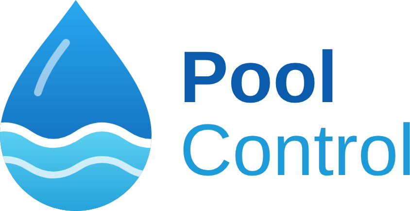

# Pool Control

Home Assistant integration that controls filtration, salt water chlorination
and pH dosing of a swimming pool using existing switch and sensor entities.

Pool Control does not talk to hardware directly. It reads sensors (pH, ORP,
water temperature, optionally weather, salt and flow) and switches existing
entities (smart relays, smart plugs) for the filter pump, the chlorinator and
the pH minus dosing pump.

## Features

- **Filtration** - Daily run time derived from the water temperature, split
  into configurable blocks within a time window. Run time is extended while
  chlorination or pH correction is needed.
- **Chlorination** - ORP controlled with hysteresis, minimum on/off times and
  a daily limit. The ORP set point is derived from the pH value and a free
  chlorine target, or set to a fixed value.
- **pH dosing** - Pulses with mixing pauses, daily limit, quiet hours, safety
  minimum and an effect check that locks dosing if the pH does not respond.
- **Water chemistry** - Manual water tests, Langelier saturation index, shock
  chlorination, stabilizer warning.
- **Maintenance** - Reminders for probe calibration, backwash and cell
  cleaning.
- **Tank tracking** - Fill level, daily and seasonal consumption. Refills
  calibrate the real pump rate.
- **Solar heating** - Differential control of a solar absorber or use of the
  switching signal of an existing solar controller.
- **PV surplus** - Pulls the filtration forward while PV surplus is available.
- **Frost protection** - Runs the pump when the outdoor temperature drops
  below a threshold, in every mode except *Off*.
- **Safety** - Chlorinator and dosing pump never run without the filter pump.
  Readings are only used after a stabilization time and while they are fresh,
  plausible and not stuck.
- **Swimming assessment** - Binary sensor and status based on pH and ORP.
- **Dry run** - Calculates all decisions and writes them to the logbook
  without switching anything.
- **Dashboard card** - Shipped with the integration: schematic, readings,
  progress, problems and actions.
- **Home Assistant standards** - Config and options flow, translated entities
  (English, German), logbook entries, events, repairs, diagnostics.

## Requirements

- Home Assistant 2026.2 or newer (icons in the UI from 2026.3)
- A switchable filter pump (`switch`, `input_boolean` or `light`)
- pH, ORP and water temperature sensors in the circulation (flow cell)
- Optional: chlorinator switch, pH minus dosing pump switch, backup sensors,
  salt sensor, weather entity or outdoor temperature sensor, flow sensor or
  pump power sensor, solar pump and collector sensor or solar demand signal,
  PV surplus sensor

## Installation

### HACS

1. HACS > Integrations > menu > *Custom repositories*
2. Add `https://github.com/AndyKausG/ha-pool_control` as type *Integration*
3. Install *Pool Control* and restart Home Assistant

### Manual

Copy `custom_components/pool_control` into the `custom_components` folder of
your configuration and restart Home Assistant.

## Setup

Settings > Devices & services > *Add integration* > *Pool Control*

1. Name, pool volume and the switches for pump, chlorinator and dosing pump
2. Sensors

All other parameters start with defaults and can be changed in the options
of the integration. See [docs/configuration.md](docs/configuration.md).

**Recommendation:** enable *Dry run* first and let the integration run in
parallel to an existing control for a few days. Compare the logbook entries
before switching over.

## Entities

| Entity | Description |
|---|---|
| `select.<pool>_operating_mode` | Automatic, Manual, Maintenance, Winter, Off |
| `sensor.<pool>_status` | Current activity; attributes contain the reasons of the last decisions |
| `sensor.<pool>_ph`, `_orp`, `_water_temperature` | Validated readings (primary or backup) |
| `sensor.<pool>_orp_set_point` | Current ORP set point |
| `sensor.<pool>_filtration_target` | Daily filtration target |
| `sensor.<pool>_pump_runtime_today` | Filter pump run time today |
| `sensor.<pool>_next_filtration` | Start of the next scheduled run |
| `sensor.<pool>_chlorinator_runtime_today` | Chlorinator run time today |
| `sensor.<pool>_ph_minus_dosed_today` / `_this_season` | Dosed amount |
| `sensor.<pool>_ph_minus_tank_level` (+ percent) | Remaining product |
| `sensor.<pool>_dosing_pump_rate` | Configured or calibrated pump rate |
| `sensor.<pool>_learned_product_dose` | Product dose observed from pH response |
| `sensor.<pool>_swimming_status` | Result of the swimming assessment |
| `sensor.<pool>_saturation_index` | Langelier saturation index |
| `sensor.<pool>_free_chlorine_test` | Free chlorine of the last water test |
| `number.<pool>_total_alkalinity`, `_calcium_hardness`, `_cyanuric_acid` | Water test values |
| `number.<pool>_shock_chlorine_target`, `_shock_duration` | Shock chlorination |
| `button.<pool>_start_shock_chlorination` / `_stop_...` | Shock chlorination |
| `binary_sensor.<pool>_swimming_allowed` | On if swimming is recommended |
| `binary_sensor.<pool>_problem` | On if any problem is active; attribute `problems` |
| `binary_sensor.<pool>_frost_protection` | Frost protection active |
| `binary_sensor.<pool>_solar_heating_demand` | Solar heating demand |
| `switch.<pool>_solar_heating_control` | Enable or disable solar heating |
| `binary_sensor.<pool>_maintenance_due` | A maintenance task is due; attribute `tasks` |
| `sensor.<pool>_next_backwash`, `_next_ph_calibration`, ... | Next due date per task |
| `button.<pool>_backwash_done`, ... | Mark a task as done |
| `binary_sensor.<pool>_ph_dosing_locked` | Dosing locked by the effect check |
| `binary_sensor.<pool>_ph_minus_tank_low` | Tank below warning level |
| `number.<pool>_ph_set_point` | pH set point |
| `number.<pool>_free_chlorine_target` | Free chlorine target (ppm) for the ORP set point |
| `number.<pool>_extra_circulation_duration` | Duration of an extra circulation |
| `switch.<pool>_dry_run` | Simulation mode |
| `switch.<pool>_chlorine_control`, `_ph_control` | Enable or disable a controller |
| `button.<pool>_start_extra_circulation` / `_stop_...` | Extra circulation |
| `button.<pool>_ph_minus_tank_refilled` | Reset the tank level |
| `button.<pool>_manual_ph_dosing_pulse` | One pulse, safety rules apply |
| `button.<pool>_release_ph_dosing_lock` | Release the effect check lock |

Entities for the chlorinator and the dosing pump are only created when the
respective switch is configured.

## Actions

| Action | Description |
|---|---|
| `pool_control.start_boost` | Extra circulation, optional duration |
| `pool_control.stop_boost` | Stop extra circulation |
| `pool_control.ph_tank_refilled` | Record a refill; `refilled_ml` calibrates the pump rate |
| `pool_control.reset_ph_lock` | Release the dosing lock |
| `pool_control.reset_season` | Reset the seasonal dosing counter |
| `pool_control.calculate_ph_correction` | Returns the product amount for a pH correction |
| `pool_control.calculate_salt_correction` | Returns the salt amount or water exchange |
| `pool_control.record_water_test` | Store alkalinity, calcium hardness, cyanuric acid, free chlorine |

## Notifications

Pool Control does not send notifications itself. It fires the event
`pool_control_event` (types `problem`, `problem_resolved`, `action`,
`simulated_action`, `interlock`, `ph_dosed`) and writes every action with its
reason to the logbook. The blueprint
[`notify_problems.yaml`](blueprints/automation/pool_control/notify_problems.yaml)
turns problems into notifications.

## Documentation

- [Control logic](docs/control-logic.md)
- [Configuration reference](docs/configuration.md)
- [Hardware example and hardware interlock](docs/hardware.md)
- [Dashboard example](docs/dashboard.md)

## Safety notice

Pool Control switches devices that dose chemicals. Configure hardware
safeguards independent of Home Assistant: an auto-off timer for the dosing
pump in the relay and an interlock between pump and chlorinator/dosing pump
(see [docs/hardware.md](docs/hardware.md)). Use the integration at your own
risk.

## License

[MIT](LICENSE)
