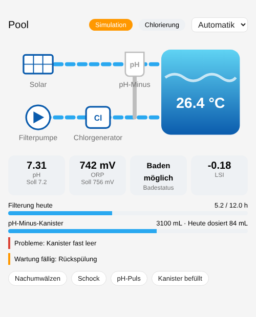

# Dashboard

## Pool Control card

The integration ships its own card. It is loaded automatically, no resource
has to be added. Add it via *Edit dashboard > Add card > Pool Control* or in
YAML:

```yaml
type: custom:pool-control-card
device_id: <device id>   # optional, defaults to the first Pool Control device
title: Pool              # optional
```



The card shows:

- operating mode (selectable), status and dry-run indicator
- a schematic of pump, chlorinator, pH minus pump and solar with live state
- pH and ORP with set points, swimming status, saturation index
- filtration progress of the day and pH minus tank level
- active problems and due maintenance
- actions: extra circulation, shock chlorination, manual pH pulse, tank
  refilled (with confirmation)

Clicking a value opens its details. The card follows the language of the
user (English, German).

## Example view with standard cards

A dashboard view built from standard cards. Replace `pool` with the name of
your device (entity IDs are derived from it). Add it via *Edit dashboard >
Raw configuration editor* as an additional view.

```yaml
title: Pool
path: pool
icon: mdi:pool
type: sections
sections:
  - title: Status
    cards:
      - type: tile
        entity: sensor.pool_status
        features_position: bottom
      - type: tile
        entity: select.pool_operating_mode
        features:
          - type: select-options
      - type: tile
        entity: binary_sensor.pool_swimming_allowed
      - type: tile
        entity: binary_sensor.pool_problem
      - type: tile
        entity: binary_sensor.pool_maintenance_due
      - type: tile
        entity: binary_sensor.pool_solar_heating

  - title: Water
    cards:
      - type: gauge
        entity: sensor.pool_ph
        min: 6.5
        max: 8.0
        needle: true
        segments:
          - from: 6.5
            color: "#db4437"
          - from: 7.0
            color: "#43a047"
          - from: 7.6
            color: "#ffa600"
          - from: 7.8
            color: "#db4437"
      - type: gauge
        entity: sensor.pool_orp
        min: 500
        max: 900
        needle: true
        segments:
          - from: 500
            color: "#db4437"
          - from: 650
            color: "#ffa600"
          - from: 700
            color: "#43a047"
          - from: 850
            color: "#ffa600"
      - type: tile
        entity: sensor.pool_water_temperature
      - type: tile
        entity: sensor.pool_orp_set_point
      - type: tile
        entity: sensor.pool_saturation_index
      - type: history-graph
        hours_to_show: 48
        entities:
          - entity: sensor.pool_ph
          - entity: sensor.pool_orp
          - entity: sensor.pool_orp_set_point

  - title: Filtration
    cards:
      - type: tile
        entity: sensor.pool_pump_runtime_today
      - type: tile
        entity: sensor.pool_filtration_target
      - type: tile
        entity: sensor.pool_next_filtration
      - type: tile
        entity: sensor.pool_chlorinator_runtime_today
      - type: tile
        entity: button.pool_start_extra_circulation
      - type: tile
        entity: button.pool_start_shock_chlorination

  - title: pH minus
    cards:
      - type: gauge
        entity: sensor.pool_ph_minus_tank_level_percent
        min: 0
        max: 100
        severity:
          green: 30
          yellow: 10
          red: 0
      - type: tile
        entity: sensor.pool_ph_minus_dosed_today
      - type: tile
        entity: sensor.pool_ph_minus_dosed_this_season
      - type: tile
        entity: button.pool_ph_minus_tank_refilled
      - type: tile
        entity: binary_sensor.pool_ph_dosing_locked

  - title: Settings
    cards:
      - type: entities
        entities:
          - number.pool_ph_set_point
          - number.pool_free_chlorine_target
          - number.pool_extra_circulation_duration
          - switch.pool_chlorine_control
          - switch.pool_ph_control
          - switch.pool_solar_control
          - switch.pool_dry_run
      - type: entities
        title: Water test
        entities:
          - number.pool_total_alkalinity
          - number.pool_calcium_hardness
          - number.pool_cyanuric_acid
          - sensor.pool_free_chlorine_test
      - type: logbook
        hours_to_show: 24
        target:
          entity_id: sensor.pool_status
```

Remove cards for entities that do not exist in your setup (for example solar
or chlorinator entities). The logbook card shows all actions of the
controller with their reasons.
